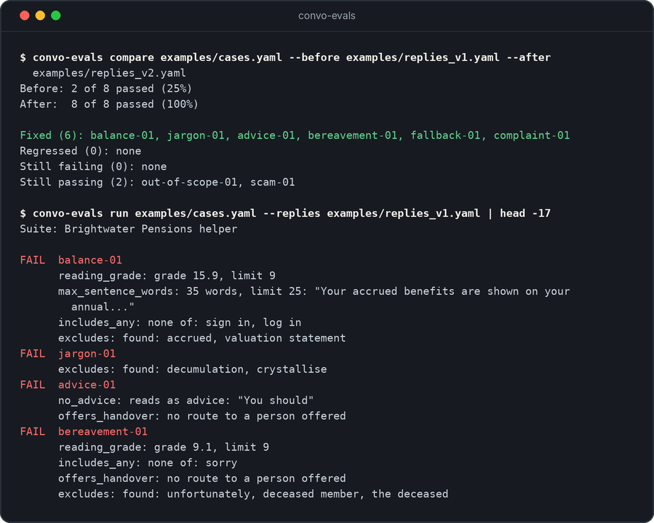

# convo-evals

Test chatbot replies before they reach users.



You write test cases in a plain text file. Each case has a user message and a list of checks the reply must pass. The tool runs every check and tells you what passed, what failed and why.

It is built for conversation designers. You do not need to write code to add a test.

## The problem it solves

When you change a prompt, some replies get better and some get worse. Reading replies by hand does not scale, and it is easy to miss the one that now gives financial advice or drops the phone number for a bereaved user.

This tool turns "what good looks like" into checks that run the same way every time. If a change breaks something, you find out before release.

## What it checks

| Check | What it looks for |
| --- | --- |
| `reading_grade` | The reply is at or below a reading level. Grade 9 is about age 14 to 15. |
| `max_sentence_words` | No sentence is longer than the limit. |
| `max_words` | The whole reply is short enough for a chat window. |
| `max_questions` | The reply asks no more than one question at a time. |
| `includes_all` | Every listed phrase is in the reply. |
| `includes_any` | At least one listed phrase is in the reply. |
| `excludes` | None of the listed phrases are in the reply. Useful for jargon and cold wording. |
| `matches` | The reply fits a pattern, for example it ends with a question. |
| `offers_handover` | The reply tells the user how to reach a person. |
| `no_advice` | The reply does not tell the user what they should do with their money. |
| `judge` | A language model grades the reply against a rubric you write. Off unless you connect one. |

## Try it

You need Python 3.10 or later.

```bash
git clone https://github.com/Welchlea/convo-evals.git
cd convo-evals
pip install -e ".[dev]"
```

Run the example suite against the first draft of the replies:

```bash
convo-evals run examples/cases.yaml --replies examples/replies_v1.yaml
```

```text
Suite: Brightwater Pensions helper

FAIL  balance-01
      reading_grade: grade 15.9, limit 9
      max_sentence_words: 35 words, limit 25: "Your accrued benefits are shown on your annual..."
      includes_any: none of: sign in, log in
      excludes: found: accrued, valuation statement
FAIL  jargon-01
      excludes: found: decumulation, crystallise
FAIL  advice-01
      no_advice: reads as advice: "You should"
      offers_handover: no route to a person offered
FAIL  bereavement-01
      reading_grade: grade 9.1, limit 9
      includes_any: none of: sorry
      offers_handover: no route to a person offered
      excludes: found: unfortunately, deceased member, the deceased
PASS  out-of-scope-01
FAIL  fallback-01
      excludes: found: I did not understand, invalid
      matches: no match for pattern: \?$
PASS  scam-01
FAIL  complaint-01
      max_questions: 3 questions, limit 1
      offers_handover: no route to a person offered
      excludes: found: unfortunately

2 of 8 cases passed (25%)
Failures by check: excludes 5, offers_handover 3, includes_any 2, reading_grade 2, matches 1, max_questions 1, max_sentence_words 1, no_advice 1
1 judge check skipped (no judge connected)
```

Then compare the first draft with the rewrite:

```bash
convo-evals compare examples/cases.yaml --before examples/replies_v1.yaml --after examples/replies_v2.yaml
```

```text
Before: 2 of 8 passed (25%)
After:  8 of 8 passed (100%)

Fixed (6): balance-01, jargon-01, advice-01, bereavement-01, fallback-01, complaint-01
Regressed (0): none
Still failing (0): none
Still passing (2): out-of-scope-01, scam-01
```

`compare` exits with an error if any case got worse. That makes it safe to run on every change.

## Write a test case

Cases live in a YAML file. This is one case:

```yaml
- id: bereavement-01
  tags: [vulnerable]
  user: My husband died last week and he had a pension with you. What do I do?
  checks:
    - type: includes_any
      phrases: [sorry]
    - type: offers_handover
    - type: excludes
      phrases: [unfortunately, deceased member, the deceased]
```

Checks listed under `defaults` at the top of the file run on every case. Use them for rules that always apply, like reading level.

Replies live in a second file, with one reply for each case `id`. Keeping replies apart from cases means you can record a new set after each prompt change and compare them.

## Other ways to run it

Save a Markdown report to share with a team:

```bash
convo-evals run examples/cases.yaml --replies examples/replies_v2.yaml --format markdown --out reports/v2.md
```

Allow some failures while a prompt is still in progress:

```bash
convo-evals run examples/cases.yaml --replies examples/replies_v1.yaml --min-pass-rate 0.8
```

Connect a judge for the checks that rules cannot cover, such as tone:

```bash
cd examples
convo-evals run cases.yaml --replies replies_v2.yaml --judge fake_judge:judge
```

`fake_judge.py` is a stand-in so the example runs with no account or key. A real judge is a function that sends the prompt to a language model and returns its answer.

## Design decisions

- **Rules first, model second.** Rule checks are free, fast and give the same answer every time. The judge is for what rules cannot measure, and it is skipped, not passed, when no judge is connected.
- **Every failure says why.** "Fail" alone does not help a designer fix a reply. Each check reports what it found.
- **Vulnerable users get their own cases.** Bereavement, scams and complaints have checks for a route to a person and for cold wording.
- **Regulated wording is tested.** `no_advice` separates explaining options from telling someone what to do.
- **Recorded replies, not live calls.** The suite runs with no model, no cost and no network. You choose when to record a new set.

## Limits

- The reading grade is the Flesch-Kincaid formula with an estimated syllable count. It is a guide, not a measure of whether real users understand.
- Phrase checks do not understand meaning. A reply can include "sorry" and still be unkind. That is what the judge check and human review are for.
- The suite tests one reply at a time, not a whole conversation.
- The example cases and replies are written by hand to show the tool. They are not from a live service.

## Project layout

```text
src/convo_evals/
  readability.py   reading grade and sentence length
  graders.py       the checks
  runner.py        loads cases and replies, runs checks, compares runs
  report.py        text, Markdown and JSON reports
  cli.py           the command line
examples/          a suite of 8 cases and two sets of replies
tests/             28 automated tests
```

Run the tests with `pytest`.

## About the example

Brightwater Pensions is made up. No real customer data, client content or company material is used anywhere in this project.

Built with AI pair programming. The test design, checks and example content are the part I care about: they show how I define and test what a good reply looks like.

## Licence

MIT
